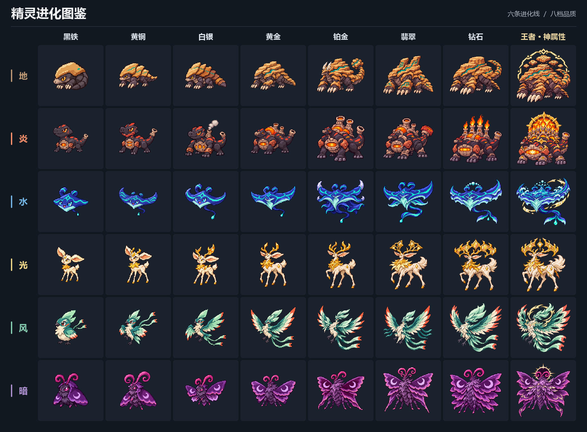

# GitMon 云端孵化、评级与立绘变更

相对 `main` 的 `5eb73d22`，本次更新打通了从单仓或整箱孵化、收下精灵到云图鉴和分享卡的流程。卡面展示仓库用途属性、社区罕见度和八档品质。总览图中每行对应一种原属性，每列对应一个品质档位。



## 孵化与云图鉴

- 登录 GitHub 或 Gitee 后，可输入单仓地址，也可用「读取我的项目」生成整箱。整箱最多选 30 个符合条件的仓库，每轮并发处理 3 个，返回进度、跳过数和失败原因。
- 两个入口调用同一套后端预览。用户可以逐包开、一键全开、逐只收下或批量收下。只有收下才写入图鉴，同一账号从不同入口重复收下同一仓库只保留一条记录。
- 仓库身份按平台和平台仓库 ID 确定，收藏按登录账号隔离，同账号跨设备可见。新一轮收藏使用独立的版本空间，已有账号从空云图鉴开始。刷新仓库数据可以更新公开认可度和品质。
- SQLite 保存仓库身份、收藏评级和 Agent 复核结果。前端通过 `/api/cloud/previews`、`/api/cloud/boxes`、`/api/cloud/pets` 完成预览、收下、查询和刷新。游客的本地图鉴保存在浏览器中。

## 属性、罕见度与品质

README 提供使用场景，发布产物说明项目交付什么，核心源码验证实际职责，语言辅助定位相关代码。规则确认仓库主用途后，按平台和仓库 ID 固定原属性。多用途项目缺少主次证据时，可请配置好的 Agent 复核。仍缺少证据时显示「属性待识别」。

| 原属性 | 仓库主用途 | 立绘进化线 |
| --- | --- | --- |
| 地 | 硬件与系统基础 | 岩甲犰狳 |
| 炎 | 软件工程与运维 | 炉心蝾螈 |
| 水 | 数据与智能 | 潮纹鳐 |
| 光 | 内容与业务体验 | 棱灯鹿 |
| 风 | 通信与连接 | 翎帆雨燕 |
| 暗 | 安全与隐私 | 影幕蛾 |

**罕见度**使用公开认可值 `P = Star + min(2 × Fork, ⌊Star / 4⌋)`。N、R、SR、UR、SE、PSE 六档的起点依次为 0、10、100、1,000、10,000、100,000。私有仓库显示「未公开评级」。

**品质**满分 230。源码基本分最高 100 分，测试与文档加分合计不超过基本分的 30%，社区加分独立计算，最高 100 分。从黑铁到王者共八档，定档同时考虑源码门槛和重算后的分数线。完整公式与各档门槛见[云卡评级规则](DESIGN.md#41-云卡罕见度与品质)。

品质的证据上下界跨档时，Agent 可复核至多两个检查项和三个原文片段，输出上限为 120 token。后端按平台、仓库 ID、提交版本和规则版本缓存结论。仍无法定档时显示「待评估」。私有仓库证据需显式启用配置才会发送。配置项见[后端说明](../backend/README.md)。

## 48 张立绘与分享卡

六种原属性各有黑铁、黄铜、白银、黄金、铂金、翡翠、钻石、王者八张 512 × 512 透明 PNG。普通卡展示原属性。王者卡面显示「神属性」，仍从原属性目录取图，例如水系王者使用 `water/08-king.png`。

后端为单仓、整箱和收藏统一返回卡面属性 `cardElement` 和立绘路径 `cardArt`。前端在开包动画、揭晓页、图鉴缩略图、详情和导出分享 PNG 时加载同一张图。原属性或品质还不足以选图时，卡面暂用已有的仓库阶段立绘。

[独立 PNG](../src/assets/creatures/) · [完整素材包](../artwork/creatures/gitmon-creatures-48.zip) · [六条进化线的创作设定](../artwork/creatures/generation-prompts.md)

## 本地对战

进入竞技场时，前端从云图鉴或本地图鉴复制只读出战快照，内含原对战属性、旧版品质、技能、六维和阶段立绘。在线对手通过独立入口读取公开仓库数据。HP、状态和胜负只在当前对局生效，对战结算不会写入图鉴或调用孵化、养成接口。详见[对战说明](BATTLE.md)。

## 部署与验证

本地部署使用 Vite 生产构建和一个 FastAPI 进程。在仓库根目录执行 `npm ci` 和 `npm run build`，进入 `backend/`，在已安装 `requirements.txt` 的 Python 环境执行以下命令。首页和 API 共用端口 8000，健康检查位于 `/api/health`。

```sh
python -m uvicorn gitmon_api.main:app --host 127.0.0.1 --port 8000
```

| 验证范围 | 本次结果 |
| --- | --- |
| 后端 | 160 项 pytest 通过，覆盖双平台预览、收下去重、账号隔离、用途识别、八档评级和品质刷新换图 |
| 生产资源 | 48 张图均可通过本地服务读取，响应中的 PNG 字节与对应原图逐张一致 |
| 浏览器 | 用水系王者测试卡核对单仓、整箱、图鉴和分享卡，从导出 PNG 抽查 2,999 个像素，与原图一致（计入透明度合成） |
| 对战 | 120 场对局自检通过，81 组属性克制与 178 个伤害样本通过回归比对 |

贡献指南汇总了目录结构、开发命令和测试约定。[AGENTS.md](../AGENTS.md)
